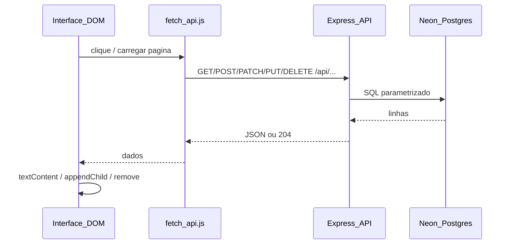

# Exemplos práticos: métodos HTTP com `fetch`

Este guia mostra, no estilo didático da disciplina, **como o LifeSync usa a função `fetch` do JavaScript** para falar com a API REST em `/api`.

Referência completa das rotas: [API.md](./API.md).

---

## 1. Contexto da API

| Item | Valor |
|---|---|
| Base | `/api` (mesma origem do site) |
| Formato | JSON |
| Autenticação | Cookie de sessão `HttpOnly` (enviado com `credentials: 'same-origin'`) |
| Escritas | `POST`, `PUT`, `PATCH`, `DELETE` exigem o cabeçalho `X-CSRF-Token` |

O token CSRF vem de:

```http
GET /api/auth/me
```

Resposta (exemplo):

```json
{
  "usuario": { "id": "...", "nome": "Murilo", "email": "dev@exemplo.com" },
  "csrfToken": "abc123..."
}
```

No código real isso fica em [`src/services/api.js`](../src/services/api.js).

---

## 2. Wrapper mínimo (o que o projeto faz por baixo)

Todos os serviços do front (`tarefasApi`, `financeiroApi`, etc.) passam por uma função parecida com esta:

```js
let csrfToken = null

async function requisitar(metodo, caminho, corpo) {
  const opcoes = {
    method: metodo,
    credentials: 'same-origin',
    headers: { Accept: 'application/json' }
  }

  // Escritas precisam do CSRF
  if (metodo !== 'GET' && csrfToken) {
    opcoes.headers['X-CSRF-Token'] = csrfToken
  }

  if (corpo !== undefined) {
    opcoes.headers['Content-Type'] = 'application/json'
    opcoes.body = JSON.stringify(corpo)
  }

  const resp = await fetch(`/api${caminho}`, opcoes)

  if (resp.status === 204) return null
  const dados = await resp.json()
  if (!resp.ok) throw new Error(dados?.erro?.mensagem ?? 'Erro na API')
  return dados
}

// Depois do login:
const me = await requisitar('GET', '/auth/me')
csrfToken = me.csrfToken
```

A partir daqui, cada método HTTP é um exemplo completo: **pedido → resposta → DOM**.

---

## 3. GET — ler dados

**Uso:** listar recursos ou buscar um resumo (não altera o servidor).

### Exemplo A — listar tarefas

```js
const { tarefas } = await requisitar('GET', '/tarefas')

const lista = document.querySelector('#task-list')
lista.replaceChildren()

for (const t of tarefas) {
  const li = document.createElement('li')
  li.textContent = t.texto
  lista.appendChild(li)
}
```

### Exemplo B — saldo do mês (dashboard)

```js
const mes = '2026-11'
const { resumo } = await requisitar('GET', `/transacoes/resumo?mes=${mes}`)

document.querySelector('#month-balance').textContent =
  `R$ ${Number(resumo.saldo).toFixed(2)}`
```

**Onde no projeto:** `src/services/tarefasApi.js`, `src/services/financeiroApi.js`, `src/pages/dashboard.js`.

---

## 4. POST — criar recurso

**Uso:** inserir um novo item (tarefa, lançamento, favorito, evento…).

### Exemplo — criar favorito

```js
const criado = await requisitar('POST', '/favoritos', {
  nome: 'Neon',
  url: 'https://console.neon.tech',
  categoria: 'Dev',
  fixado: true
})

const atalho = document.createElement('a')
atalho.href = criado.favorito.url
atalho.textContent = criado.favorito.nome
atalho.target = '_blank'
document.querySelector('#shortcuts').appendChild(atalho)
```

### Exemplo — criar despesa

```js
const { transacao } = await requisitar('POST', '/transacoes', {
  type: 'expense',
  description: 'Açaí',
  category: 'Alimentação',
  amount: 16,
  date: '2026-11-16'
})

console.log('Criada:', transacao.id)
```

**Onde no projeto:** `src/services/favoritosApi.js`, `src/services/financeiroApi.js`.

---

## 5. PATCH — atualizar parcialmente

**Uso:** mudar só alguns campos de um recurso já existente.

### Exemplo — editar texto de uma tarefa

```js
const id = 'uuid-da-tarefa'
const { tarefa } = await requisitar('PATCH', `/tarefas/${id}`, {
  texto: 'Treinar (atualizado)'
})

const item = document.querySelector(`[data-task-id="${id}"]`)
if (item) item.textContent = tarefa.texto
```

### Exemplo — fixar/desafixar favorito

```js
await requisitar('PATCH', `/favoritos/${id}`, { fixado: false })
document.querySelector(`[data-fav-id="${id}"]`)?.remove()
```

**Onde no projeto:** `src/services/tarefasApi.js`, `src/services/favoritosApi.js`, `src/services/eventosApi.js`.

---

## 6. PUT — substituir / definir estado completo de um sub-recurso

**Uso no LifeSync:** operações que **substituem** um bloco inteiro (meta, checklist, status do dia), não um “merge” solto.

### Exemplo A — definir meta financeira

```js
const { meta } = await requisitar('PUT', '/meta', {
  nome: 'Reserva de emergência',
  valor: 5000,
  prazo: '2026-12'
})

document.querySelector('#meta-valor').textContent =
  `R$ ${Number(meta.valor).toFixed(2)}`
```

### Exemplo B — marcar status da tarefa no dia

```js
const dia = '2026-11-16'
const { tarefa } = await requisitar(
  'PUT',
  `/tarefas/${id}/status/${dia}`,
  { status: 'concluida' }
)

document.querySelector('#task-progress-label').textContent =
  'Progresso atualizado'
```

### Exemplo C — substituir checklist

```js
await requisitar('PUT', `/tarefas/${id}/checklist`, {
  itens: [
    { texto: 'Aquecer', feito: true },
    { texto: 'Correr 5 km', feito: false }
  ]
})
```

**Onde no projeto:** `src/services/financeiroApi.js` (`put` meta), `src/services/tarefasApi.js` (`put` status/checklist).

---

## 7. DELETE — remover recurso

**Uso:** apagar um item. Muitas rotas respondem `204` (sem corpo).

### Exemplo — excluir lançamento

```js
await requisitar('DELETE', `/transacoes/${id}`)

document.querySelector(`[data-tx-id="${id}"]`)?.remove()
```

### Exemplo — excluir favorito

```js
await requisitar('DELETE', `/favoritos/${id}`)
document.querySelector(`[data-fav-id="${id}"]`)?.remove()
```

**Onde no projeto:** `src/services/financeiroApi.js`, `src/services/favoritosApi.js`, `src/services/tarefasApi.js`.

---

## 8. Resumo: método → arquivo do front

| Método | Exemplos de rota | Serviço |
|---|---|---|
| **GET** | `/tarefas`, `/eventos`, `/transacoes/resumo`, `/favoritos`, `/auth/me` | `*Api.js`, `api.js` |
| **POST** | `/tarefas`, `/transacoes`, `/favoritos`, `/eventos`, `/cartoes` | `tarefasApi`, `financeiroApi`, `favoritosApi`, `eventosApi`, `cartoesApi` |
| **PATCH** | `/tarefas/:id`, `/favoritos/:id`, `/eventos/:id`, `/preferencias` | idem |
| **PUT** | `/meta`, `/tarefas/:id/status/:dia`, `/tarefas/:id/checklist`, `/fuso` | `financeiroApi`, `tarefasApi` |
| **DELETE** | `/transacoes/:id`, `/tarefas/:id`, `/favoritos/:id`, `/eventos/:id` | idem |

---

## 9. Fluxo completo (do clique ao DOM)



1. Usuário interage na página (HTML).
2. O módulo chama `api.get/post/patch/put/delete`.
3. `fetch` envia o pedido REST ao Express.
4. O servidor valida, consulta o banco e responde JSON.
5. O JavaScript atualiza a interface com **DOM** (`textContent`, `appendChild`, `replaceChildren`, `remove`).

---

## 10. Como testar localmente

1. `npm run dev:api` e `npm run dev`
2. Abra `http://127.0.0.1:5173` e faça login Google
3. No DevTools → Network, filtre `/api` e observe os métodos ao criar/editar/apagar itens
4. Ou rode a suíte: `npm test` (cobre as rotas no servidor)

Mais detalhes de setup: [DEPLOY.md](./DEPLOY.md) · Visão geral: [README](../README.md)
